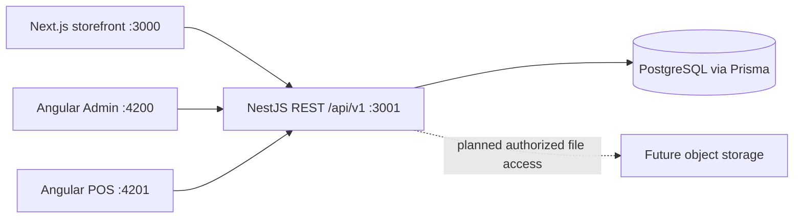

# Architecture

Applications run independently in npm workspaces. Shared code lives in `packages/shared`; keep it framework-neutral and free of secrets, database clients, and backend-only dependencies. No business contracts have been invented yet.

Only the API accesses PostgreSQL. Nest modules own domain logic when implemented. General health must not depend on database availability; database health performs an actual query and exposes only a safe status. CORS uses explicit configured origins. Frontend public environment values are not secrets.

Current development uses local PostgreSQL and database `twenty9_eleven`. Runtime connections use `DATABASE_URL`; Prisma CLI prefers `DIRECT_URL`. Managed PostgreSQL (Neon is one possibility) is deferred to deployment. See [database setup and deployment planning](database-deployment.md) for secure local provisioning and the provider-neutral migration approach.

Catalog records will describe sellable products; inventory will describe physical materials. Their connection requires later business rules. Customer identity will support guest order access and optional passwordless accounts. Neither is implemented during initialization.

File storage integration, upload authorization, malware checks, retention, hosting, authentication, and deployment are future decisions. POS offline architecture is described in [offline-pos.md](offline-pos.md).

Phase 3 provides a documentation-only [database design draft](database-architecture.md), [six domain ERDs](database-erd.md), [catalog import plan](catalog-import-design.md), [incremental roadmap](database-implementation-roadmap.md) and [open decisions](database-open-questions.md). Category, Product and ProductAttribute are now implemented as Prisma definitions under Phase 3A; their migration SQL is prepared but not applied. Other relationships remain review proposals, not implemented modules. Customer records remain independent of authentication; customer OTP/onboarding and offline POS are deferred. The source workbook is available in `docs/references/` and was independently inspected; its 36 rows remain distinct sellable products.
