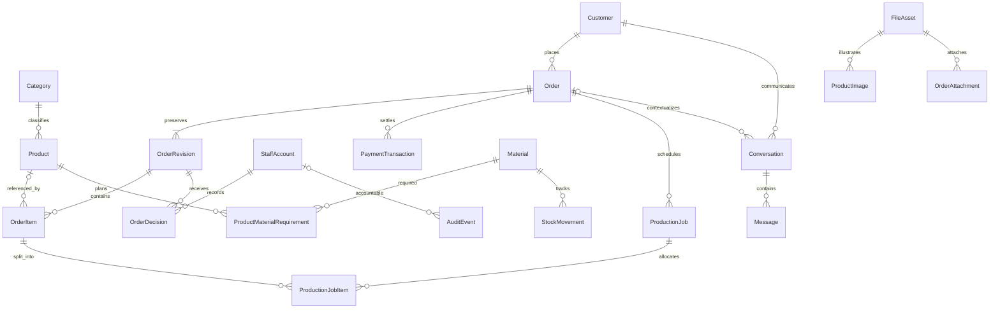
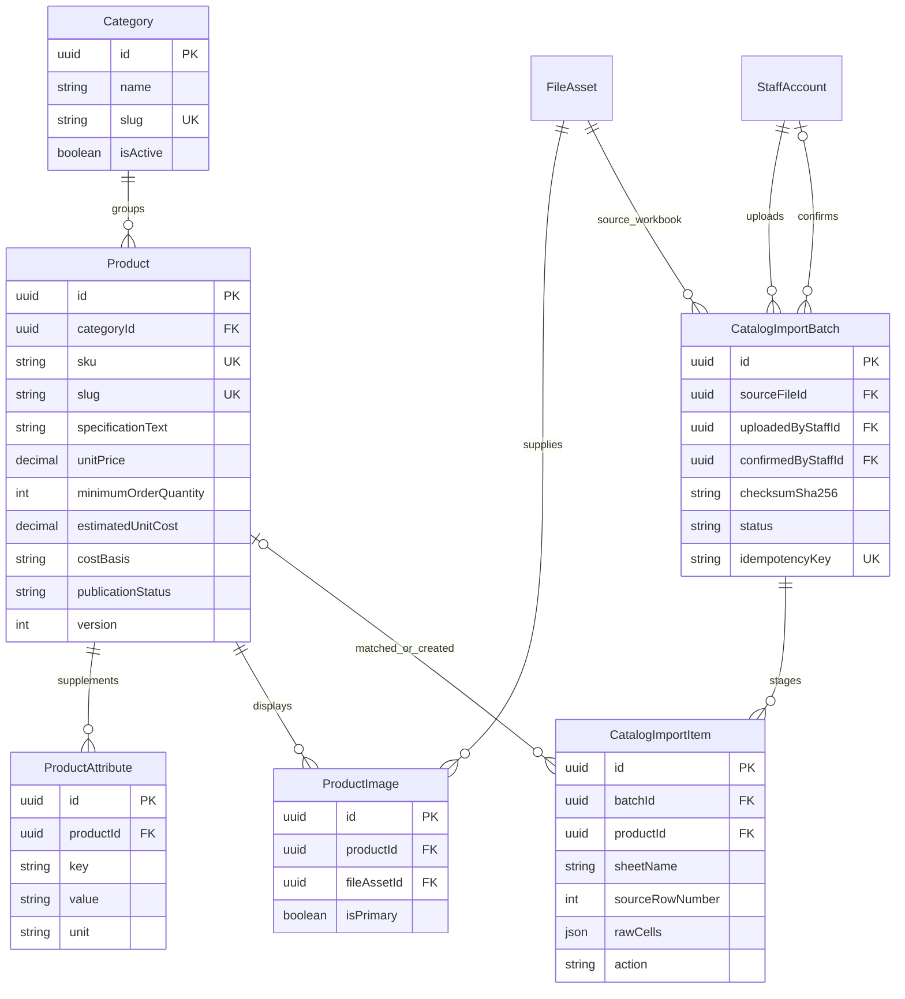
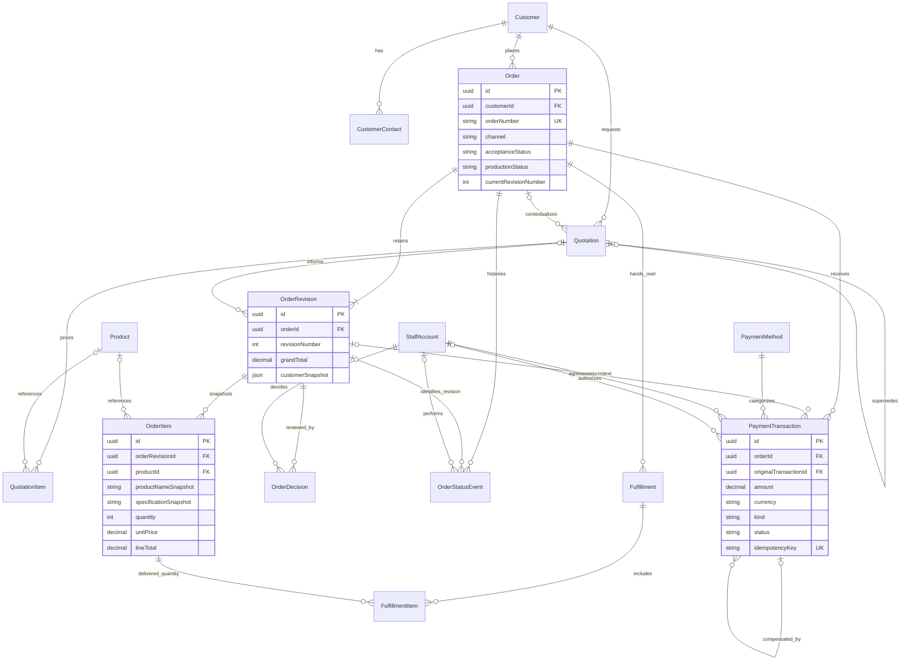
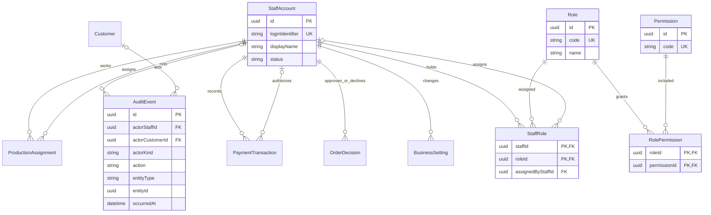
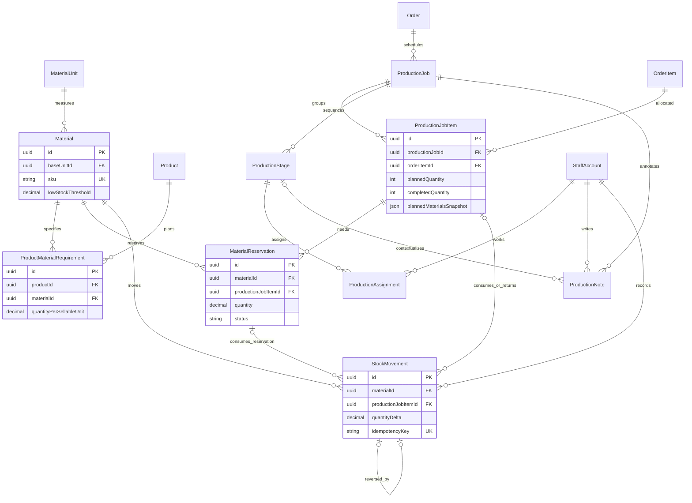
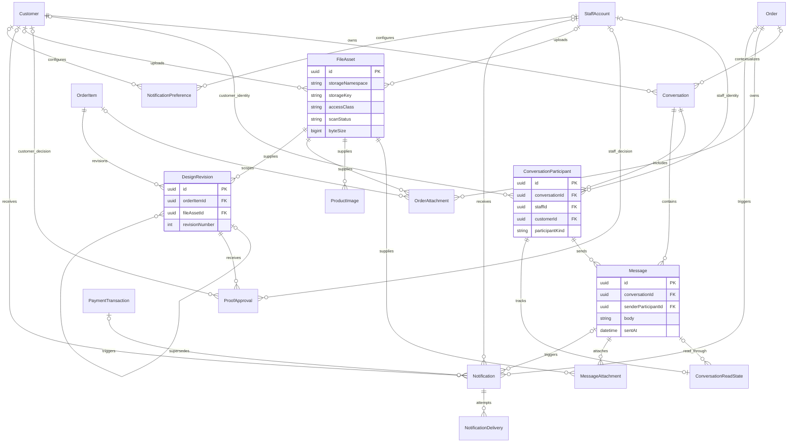

# Proposed database ERDs

Phase 3A update: Category, Product and ProductAttribute Prisma definitions are implemented; the SQL migration is prepared but no tables were created. All other entities remain conceptual. [Database specification](database-architecture.md) defines fields, constraints and cross-parent invariants not expressible in crow's-foot notation. Model names agree across diagrams. `||` exactly one, `o|` zero or one, `o{` zero or many, `|{` one or many. Relationships show referenced-parent cardinality, not whether an entire module must exist on day one. Draft aggregates may be empty before submission; accepted/scheduled aggregates require children as explained below. These are domain views, not exhaustive column inventories. Future CustomerIdentity and ProductVariant are labeled future in prose and omitted from operational diagrams.

## 1. High-level ecosystem/domain ERD

All three frontends (Admin, POS and storefront) use the same API business database; applications are clients, not database entities.

Product references on OrderItem are nullable (custom-line recommendation). Accepted revisions and scheduled jobs require at least one line, although drafts can have none. Detailed views and the written specification supply additional constraints.

## 2. Detailed catalog and import ERD

Phase 3A catalog details: specificationText is nullable; SKU is database-trigger-generated and immutable; costBasis is REVERSE_CALCULATED_ESTIMATE or MANUAL_ESTIMATE (nullable without an estimate); DRAFT/PUBLISHED/ARCHIVED are approved enum states. ProductImage and import entities remain future scope.

ProductImage uses FileAsset.storageKey rather than a duplicate key column. CatalogImportItem.productId is nullable until a match/create succeeds; raw source rows persist independently of catalog changes. Batch may be empty before parsing. Future ProductVariant would belong to exactly one Product, have its own sellable SKU/price/minimum, and be optional on future order/quote lines; no automatic conversion of these workbook products.

## 3. Customer, order and payment ERD

An order has a current revision through `(id,currentRevisionNumber)`; the OrderRevision child relationship also includes all historical/proposed revisions. Current-pointer composite FK is described in prose to avoid a visually ambiguous second edge. Online acceptance gates production; POS acceptance is recorded by authorized staff. Refund/reversal original reference nullable only for receipts. Same-order/currency invariants and cumulative bounds require additional enforcement. Payment is a transaction concept, not an extra aggregate table.

## 4. Administration and staff ERD

Audit actors are XOR staff/customer or system with neither. These edges are alternate actor associations, never a requirement for both. Role names and permission codes remain provisional. Staff login/session/provider implementation is not designed or enabled by these diagrams.

## 5. Inventory and production ERD

JobItems must reference accepted items in the job's order; one order can have multiple jobs, and one item multiple allocations. Draft jobs may be empty; scheduling requires at least one JobItem. On-hand and available stock are derived; no separate InventoryStock or MaterialUsage authority. Partial reservation consumption adjusts remaining quantity with audit and immutable usage movements. Exact movement reversal is at most one compensating movement per original.

## 6. Messaging, files and notifications ERD

Participant identities, file upload actors, proof actors and notification recipients use documented XOR checks; optional edges are not permission to leave required actors unspecified. File upload actor may explicitly be system. Message sender/read cursor must be in the same conversation, which must match its linked order/customer. Notification source FKs must share customer/order context. Authentication, upload access grants, delivery transport and real-time messaging remain future designs.

## Validation scope

Six ERD blocks were structurally checked for relationship cardinality tokens, balanced entity attribute blocks and documented entity names. No installed `mmdc`, `mermaid` package or `@mermaid-js/parser` was found in the workspace tools checked. Actual Mermaid parser/render validation therefore remains **unverified**; no dependency was installed for this documentation task. Render all six diagrams in a Mermaid-capable viewer before approving implementation, and resolve any viewer-specific syntax/layout issues. Structural checks are not a substitute for that render check.
